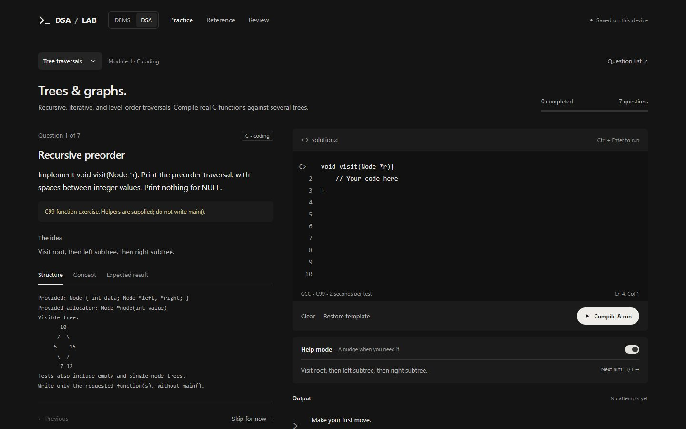

# SQL + DSA Lab

A local practice website for **Oracle-style SQL, PL/SQL, and Data Structures & Algorithms**. Read a question, write an answer, run it, and learn from the feedback.

[](https://github.com/gaurvknsl/sql-lab/actions/workflows/tests.yml)
[](https://github.com/gaurvknsl/sql-lab/actions/workflows/portable.yml)

**147 exercises · 17 rounds · Works offline after download**

[Download the latest Windows ZIP](https://github.com/gaurvknsl/sql-lab/releases/latest/download/SQL-DSA-Lab-Portable.zip) · [Releases](https://github.com/gaurvknsl/sql-lab/releases) · [Report an issue](https://github.com/gaurvknsl/sql-lab/issues)



## Start on Windows — no installation

1. Download **SQL-DSA-Lab-Portable.zip** from the latest release.
2. Extract the **entire ZIP** to a normal folder.
3. Open **start.exe**. The website opens automatically in your browser.
4. Choose **DBMS** or **DSA** in the header.

The portable package includes Python and a C compiler for **Windows 10/11 on 64-bit Intel/AMD laptops**. No Oracle, Node.js, API key, account, or separate Python/compiler installation is needed. Keep the console window open while practicing; press **Ctrl+C** or close it to stop.

Use `start.cmd` if you prefer the script launcher. Do not run the app from inside the ZIP. If the browser does not open, visit **http://127.0.0.1:8765/?mode=dsa**.

An occupied port can be changed with `start.exe --port 8766`. Use that port in the browser URL too.

## What you can practice

| Mode | Exercises | Rounds | Topics |
| --- | ---: | ---: | --- |
| DBMS | 107 | 12 | SQL queries, joins, groups, nested/correlated queries, PL/SQL blocks, cursors, procedures, functions, triggers, hospital assignment, timed mock |
| DSA | 40 | 5 | Trees, BSTs, expression/threaded trees, AVL and Red-Black traces, graph representations, DFS/BFS, components, spanning trees |

### DSA rounds

| Round | Questions | Practice |
| --- | ---: | --- |
| Tree traversals | 7 | Recursive and iterative preorder/inorder/postorder; level order |
| Tree operations & BST | 7 | Count, height, deep copy, equality, search, insertion, deletion |
| Expression, threaded & balanced trees | 11 | Expression construction/evaluation, threaded insertion/traversal, AVL rotations, Red-Black properties |
| Graph representations & traversals | 7 | Degree, DFS, BFS, components, spanning forests, adjacency matrix/list |
| Graph concepts & exam traces | 8 | Definitions, paths/cycles, directed degrees, connectivity, traversal traces, spanning trees, complexity |

DSA has **25 C function exercises** and **15 written traces**. Write only the requested functions; the runner supplies headers, structures, and a test `main`. C solutions are compiled and checked against several cases. AVL insertion/rotations and Red-Black questions use written traces.

## Learning features

- Question structure or schema, sample data, and expected output beside the editor.
- Help mode with concepts, progressive hints, and worked solutions.
- Compiler errors and result feedback; C programs have a two-second limit per test.
- Review for difficult questions and assisted attempts.
- A 60-minute, 40-mark DBMS mock exam.
- Saved drafts and progress, with separate storage for DBMS and DSA.

Progress lives in the current browser on the current laptop. Keep the same browser profile and port to retain it. The ZIP and GitHub repository do not contain personal progress. Review provides a JSON export.

## Run from source — Windows, macOS, Linux

You need **Python 3.10+**. C coding exercises also need **GCC or Clang on PATH**; DBMS and written traces work without a compiler.

```sh
git clone https://github.com/gaurvknsl/sql-lab.git
cd sql-lab
python3 start.py --mode dsa
```

On Windows, use `py -3 start.py --mode dsa` or double-click `start.cmd`. On macOS/Linux, use `sh start.sh --mode dsa`; macOS also has `start.command`. To start directly in DBMS mode, omit `--mode dsa`.

The browser opens at **http://127.0.0.1:8765**. Keep the terminal open. No pip packages or frontend build step are needed.

> The source runs across these operating systems. The prebuilt runtime and compiler inside the Windows ZIP are Windows-only.

## Update your copy

**Portable ZIP:** download the latest release and extract it to a fresh folder. Keep using the same browser and port for existing progress.

**Git checkout:** stop the server, run `git pull --ff-only`, then start it again.

Every push to `main` runs tests and builds a portable ZIP in GitHub Actions. Tagged `v*` versions publish that ZIP as a GitHub Release. The latest stable release and the latest main-branch build can therefore differ.

## How the runners work

**DBMS:** Oracle-style SQL is adapted to fresh SQLite in-memory fixtures. A local interpreter executes the supported PL/SQL subset. Answers are checked by output or behavior across changing data, rather than by matching reference-answer text. See the [detailed DBMS guide](docs/DBMS_GUIDE.md) for supported syntax, assignment details, and limitations.

**DSA:** GCC/Clang in source installs, or bundled TinyCC in the Windows package, compiles submitted C functions with a provided test harness. Checks include empty trees, isolated vertices, disconnected graphs, and pointer-copy independence. Written traces compare the requested values and order. Behavioral tests do not prove an algorithm's complexity.

The server binds only to **127.0.0.1** and rejects cross-origin submissions. SQL/PLSQL practice is a teaching subset, **not a full Oracle installation**. C code runs on your computer with time limits and **is not a security sandbox**: use your own practice code. This app is intended for local use, not public server hosting.

## Development and checks

```sh
python -m unittest discover -v
python start.py --help
```

The suite currently has **66 tests**, including every reference solution, wrong-answer cases, HTTP endpoints, compiler feedback, and execution timeouts. C tests require a compiler; without one, the relevant tests are explicitly skipped. CI runs on Windows, Linux, and macOS.

| Path | Purpose |
| --- | --- |
| `server.py` | HTTP endpoints and DBMS grading |
| `engine.py` | Oracle helpers, fixtures, PL/SQL interpreter |
| `questions.py`, `hospital.py` | DBMS curriculum and assignment data |
| `dsa.py` | DSA curriculum, C harnesses and grading |
| `public/` | HTML, CSS, JavaScript and icon |
| `scripts/build_portable.py` | Portable Windows package builder |
| `scripts/start_windows.c` | Source for the native `start.exe` launcher |
| `.github/workflows/` | Test matrix and portable build/release workflows |
| `AGENTS.md` | Project maintenance instructions |

### Build the Windows ZIP

On Windows with Python 3.13 installed:

```powershell
py -3.13 scripts/build_portable.py
```

The builder downloads checksum-verified TinyCC binaries and matching source, bundles the current Python runtime without site packages, and creates `dist/SQL-DSA-Lab-Portable.zip` plus a SHA-256 checksum. Its first build needs internet access. Build inputs can be placed in `build/downloads` beforehand for an offline rebuild.

Third-party runtime/compiler licenses and corresponding TinyCC source are included in the ZIP. [Python](https://www.python.org/) and [TinyCC](https://bellard.org/tcc/) remain the work of their respective authors.

See [CHANGELOG.md](CHANGELOG.md) for release changes. The supplied syllabus slide decks are not required or redistributed.
